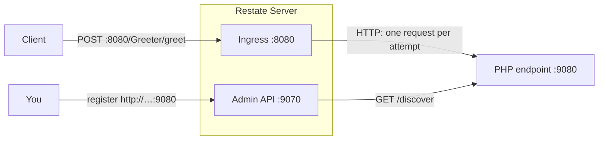
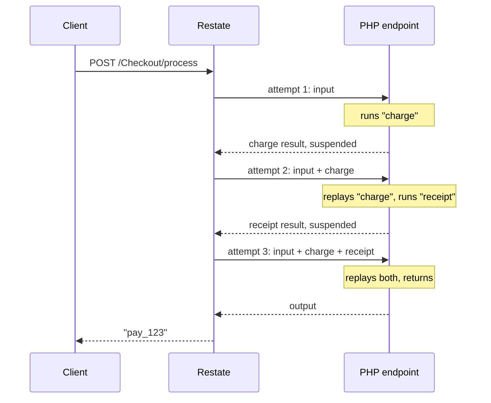

# How Restate runs PHP handlers

This page explains what happens between a client's request and your PHP handler: where Restate sits, how the journal makes handlers durable, why a handler runs several times, and what that means for the code you write and the way you deploy it. Read it before the [develop](develop/services.md) pages if Restate is new to you.

## Services, handlers and invocations

Your business logic lives in **services**: PHP classes whose methods are **handlers**. A service is a Basic Service, a Virtual Object (keyed, with state) or a Workflow ([Services](https://docs.restate.dev/foundations/services)). One PHP application, the **endpoint**, serves one or more services over HTTP.

The Restate Server sits in front of your endpoint, like a reverse proxy. Clients never call PHP directly: they call Restate, and Restate calls your endpoint.



| Port | What it is |
| --- | --- |
| 8080 | Restate's **ingress**: clients call handlers here, for example `POST /Greeter/greet` or `POST /Counter/my-key/add` for a Virtual Object |
| 9070 | Restate's **admin API**: you register endpoints, inspect and manage invocations |
| 9080 | Your PHP endpoint (any port works; 9080 is the convention). Only Restate needs to reach it |

Before Restate can call your handlers, you **register** the endpoint as a **deployment**: you give the admin API the endpoint's URL, and Restate calls the endpoint's `/discover` path to learn which services and handlers it serves ([Registering the deployment](serving.md#registering-the-deployment)).

Each request to run a handler is an **invocation**. Restate gives it an id (`inv_…`), stores it, and tracks it until it completes, retrying it through crashes and failures ([Key concepts](https://docs.restate.dev/foundations/key-concepts)).

## The journal and replay

Every action a handler takes through its context (`$ctx->run()`, `$ctx->call()`, `$ctx->send()`, `$ctx->sleep()`, reading and writing state, creating an awakeable, …) is recorded in the invocation's **journal**, which Restate stores. The journal holds both the action and its result.

When an attempt fails, Restate runs the handler again, **from the top**. This is **replay**. Each time the handler reaches an action that is already in the journal, the SDK returns the recorded result instead of doing the work again: a `$ctx->run()` callback is not called, a call is not sent again.

```php
<?php

use Restate\Attributes as Restate;
use Restate\Context;

#[Restate\Service('Checkout')]
final class Checkout
{
    #[Restate\Handler]
    public function process(Context $ctx, string $orderId): string
    {
        // chargeCard() and sendReceipt() stand for your own code
        $paymentId = $ctx->run('charge', fn (): string => chargeCard($orderId));
        $ctx->run('receipt', fn () => sendReceipt($orderId, $paymentId));

        return $paymentId;
    }
}
```

If sending the receipt throws, Restate retries the invocation. On the retry the handler starts again, gets `$paymentId` from the journal without charging the card a second time, and tries the receipt again.

Code that is not a context action, such as plain PHP between the `$ctx->run()` calls, runs again on every attempt. `$ctx->isReplaying()` tells you whether the handler is still replaying recorded actions, and `$ctx->logger()` drops log records while it is, so each line is logged once per invocation ([Logging from handlers](develop/logging-and-hooks.md#logging-from-handlers)).

## Request/response mode and suspension

The PHP SDK serves Restate's **request/response** mode: each attempt is exactly one HTTP request. Restate sends the invocation's input and its journal so far; the endpoint replays, runs the handler until it finishes or has to wait, and answers with the new journal entries.

When the handler needs a result that Restate has not sent yet, the attempt ends there. This is a **suspension**. It happens when the handler waits for:

- a sleep or timer (`$ctx->sleep()`),
- the result of a call to another handler,
- an awakeable, a signal or a durable promise,
- the acknowledgement of a `$ctx->run()` result: Restate must record a step's result before the handler may continue, so **every `$ctx->run()` ends the attempt**.

Once the endpoint has answered, the request is over and no PHP code runs for this invocation. When the result exists (the timer fires, the callee returns, the step is recorded), Restate sends a new request, and the handler replays up to the point where it stopped and carries on.



What this means for you:

- **No PHP worker waits.** A handler that sleeps for a day or waits a week for an awakeable holds no php-fpm child, thread or connection in the meantime.
- **N steps take N + 1 requests.** The `Checkout` handler above takes three requests (measured with Restate 1.8.1 and `php -S`).
- **Long journals cost quadratic replay.** Every attempt replays the whole journal so far, so the total replay work grows with the square of the number of steps. A few dozen steps cost little; thousands cost a lot. Batch work into fewer `$ctx->run()` steps or split long loops into child invocations ([Long journals](serving.md#long-journals-cost-quadratic-replay)).
- **Suspension unwinds your handler.** To stop the handler mid-way, the SDK throws an internal `\Error`. `catch (\Exception)` and `catch (\Restate\Exception)` do not see it, but `catch (\Throwable)` and `catch (\Error)` do: do not use them around context calls ([Never catch Throwable around context calls](develop/errors.md#never-catch-throwable-around-context-calls)). A suspension is not a failure: it is neither retried nor logged as an error.

Restate also has a bidirectional streaming mode, in which one attempt can run a whole invocation. It needs a server that hands PHP the request body while it is still arriving; php-fpm, FrankenPHP and `php -S` all buffer the body first, so the SDK does not offer it ([Request/response protocol mode](serving.md#requestresponse-protocol-mode)).

## Determinism

Because the handler re-runs from the top on every attempt, the code outside `$ctx->run()` must take the **same path** each time: the same context actions, in the same order, with the same arguments. Anything that can change between attempts must come from the journal.

| Instead of | Use | Why |
| --- | --- | --- |
| `time()`, `microtime()`, `new DateTimeImmutable()` | `$ctx->now()` | Records the time (epoch milliseconds) as a durable step, so replay sees the same value |
| `random_int()`, `mt_rand()`, `random_bytes()` | `$ctx->randInt($min, $max)`, `$ctx->randBytes($length)` | Seeded from the invocation id: the same values on every attempt, with no journal entry |
| `uniqid()`, a UUID library | `$ctx->uuid()` | A version 4 UUID from the same seed |
| An HTTP request, a database query, reading a file | `$ctx->run('name', fn () => …)` | The result is recorded once and replayed after |

```php
<?php

use Restate\Context;
use Restate\Target;

// Inside a handler that takes Context $ctx.

// Wrong: on a retry the handler may take the other branch.
if (random_int(0, 1) === 1) {
    $ctx->send(Target::service('Audit', 'sample'), 'checkout');
}

// Right: the same value on every attempt.
if ($ctx->randInt(0, 1) === 1) {
    $ctx->send(Target::service('Audit', 'sample'), 'checkout');
}
```

If replay issues an action that does not match what the journal recorded at that position (another kind of action, or different arguments), the attempt fails with a **journal mismatch** (Restate error [RT0016](https://docs.restate.dev/references/errors#rt0016)). Retrying does not help, because the code takes the same wrong path every time. The usual causes are non-deterministic code and code changed behind a deployment that still has invocations in flight (see [Deployments and versioning](#deployments-and-versioning)). The endpoint's logger receives the full description of the mismatch at debug level ([Logs from the extension](develop/logging-and-hooks.md#logs-from-the-extension)).

The callback of a `$ctx->run()` runs **at least once**: if the attempt dies after the callback ran but before Restate recorded its result, the next attempt runs it again. Make side effects idempotent where you can, for example by passing an idempotency key to the API you call ([Durable steps](develop/durable-steps.md)).

## Retries and terminal errors

Restate distinguishes two kinds of failure:

- **Any exception** a handler throws fails the attempt. Restate retries the invocation with exponential backoff, following its retry policy, and the retry replays the journal.
- A **`TerminalError`** fails the invocation for good: no retries. The caller gets the error. Use it for failures that retrying cannot fix, such as a declined payment or invalid input.

The same applies inside a step. An exception thrown by a `$ctx->run()` callback makes Restate retry the step; a `TerminalError` is recorded as the step's result and thrown from `$ctx->run()`, now and on every replay.

[Error handling](develop/errors.md) covers both, along with retry policies, retrying after a delay, pausing an invocation and mapping your own exceptions.

## Deployments and versioning

A **deployment** is one endpoint URL registered with Restate ([Registering the deployment](serving.md#registering-the-deployment)). Restate treats deployments as **immutable**: every retry and resumption of an invocation goes to the deployment the invocation started on, because replaying a journal needs the code that wrote it ([Versioning](https://docs.restate.dev/services/versioning)). New invocations go to the latest deployment that has the service.

To release a new version of your services:

1. Deploy the new code at a **new URL**, next to the old one (another host name, port or container).
2. Register the new URL. New invocations go to it; invocations in flight stay on the old deployment.
3. **Keep the old deployment running until it drains.** `restate deployment describe <deployment_id> --extra` lists its in-flight invocations.
4. Remove the old deployment (`restate deployments remove <deployment_id>`), then shut it down.

Replacing the code behind a URL that is already registered (a `git pull` on the server, a new image with the same address) makes in-flight invocations replay against code that did not write their journal. Changing what happens inside a `$ctx->run()` callback is safe. Adding, removing or reordering context actions, or changing their arguments, leads to journal mismatches ([Fixing a bug by updating deployed code](https://docs.restate.dev/services/versioning#fixing-a-bug-by-updating-deployed-code)). To move a stuck invocation to a fixed deployment, pause it and resume it there (`restate invocations resume <invocation_id> --deployment <deployment_id>`).

A few more rules from Restate:

- **Registering a URL that is already registered changes nothing.** Restate cannot tell that the code behind it changed, so it keeps the services and handlers it discovered first (checked with Restate 1.8.1).
- **`force: true`** (`--force` with the CLI) replaces the deployment at that URL in place: Restate discovers the services again, and in-flight invocations continue on the new code. Use it in **development only**, after you add or rename handlers.
- **Breaking changes are refused.** A new deployment that removes or renames a handler, or changes a service's type, fails to register unless you pass `--breaking` (implied by `--force`). Update callers first.
- **State outlives deployments.** Virtual Object state carries over to the new version, so keep its format backward compatible.
- **Long waits pin old code.** An invocation that sleeps for a month keeps its deployment alive for a month. Prefer short handlers that schedule follow-up work with delayed messages ([Scheduling with delayed messages](develop/timers.md#scheduling-with-delayed-messages)).

## Next steps

- [Services](develop/services.md): define services and handlers with attributes or builders, and put them on an endpoint.
- [Durable steps](develop/durable-steps.md): `$ctx->run()`, retry policies, deterministic time and random values.
- [State](develop/state.md), [Communication](develop/communication.md), [External events](develop/external-events.md) and [Timers](develop/timers.md): the rest of the context.
- [Error handling](develop/errors.md): terminal and retryable errors in detail.
- [Serving](serving.md): run the endpoint under `php -S`, php-fpm or FrankenPHP, register it, and the PHP settings it needs.

## Design notes

- [Bidirectional streaming](decisions/0007-bidirectional-streaming.md): why the SDK serves request/response mode only.
- [Suspension is not an exception](decisions/0013-suspension-is-not-an-exception.md): how a suspension unwinds the handler.
